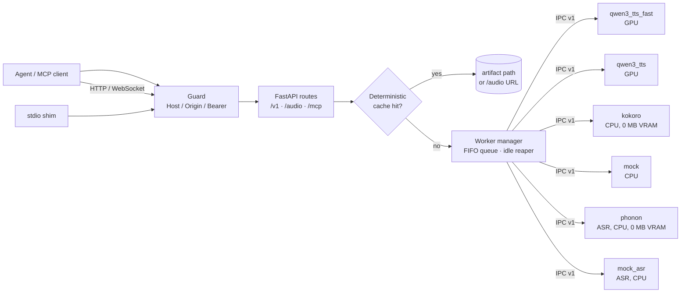

<div align="center">

# agent-voice

**Headless, local-first, multi-engine voice cloning, speech synthesis and transcription server for AI agents.** An optional static Studio SPA ships at `/ui`; the core daemon remains headless and Node-free.

[](CHANGELOG.md)
[](pyproject.toml)
[](LICENSE)

</div>

> **Status: Beta (v0.7.0).** Install with one command, then let `agent-voice setup`
> detect the hardware. Linux + NVIDIA CUDA is verified on an RTX 4060 Ti 16 GB (driver
> 580.178.04, torch 2.11.0+cu128); the CPU engines are verified everywhere. Apple-silicon
> MPS, AMD ROCm and Windows are **experimental/unverified** — see the
> [device support matrix](#device-support).

An agent asks for speech over MCP or HTTP; `agent-voice` keeps the GPU idle until
something actually needs it, routes the request to an isolated engine subprocess,
and returns a file path or a PCM stream. No desktop app, no web UI, no base64 blobs
in tool results. Most local TTS servers are built for humans — a window, a waveform,
a "Generate" button. Agents need deterministic caching, honest error codes, a GPU
that is genuinely free when idle, and tools that return compact JSON. Since v0.5.0
the same plugin system also runs **speech recognition**, so an agent can watch a
video, read it, and re-voice it.

## At a glance

| | |
|---|---|
| **Daemon** | FastAPI + FastMCP, Python 3.12, core venv installs **no torch** |
| **Engines** | `mock` (CPU tone generator), `kokoro` (82M TTS, **CPU default**), `qwen3_tts` (official), `qwen3_tts_fast` (CUDA graphs), `phonon` (ASR, **CPU default**), `mock_asr` (ASR, no deps) |
| **Kinds** | `kind: tts` speaks, `kind: asr` listens; `device: cpu` engines never take the GPU slot |
| **Devices** | `auto` · `cpu` · `cuda` · `mps` · `rocm`, per engine — `AGENT_VOICE_DEVICES`, or `engines install <id> --device` to pick the lock root |
| **Voice modes** | clone a 3–10 s clip · nine Qwen preset speakers · eight Kokoro voices · design a voice from words |
| **Zero-GPU option** | Kokoro-82M (TTS) on **`device=cpu`**: **0 MB VRAM**, native 24 kHz, **3.4–5.2× real time**, 1.37 GB RSS |
| **Transcription** | Phonon-2.5 on the **CPU**: 25 languages, **0 MB VRAM**, **≈42–48× real time** on a Ryzen 7 5700X, 156 MB download |
| **Dubbing** | Two-stage: `dub prepare` (transcribe + speaker ref) → agent translates → `dub render` (speak in the original slots) |
| **Markup** | `[pause 1.5s]`, `[slow]`, `[fast]`, `[emphasis]`, `[spell]`, paragraph gaps — parsed before synthesis |
| **Interfaces** | MCP (stdio + Streamable HTTP), REST, OpenAI-compatible (speech **and** transcriptions), raw PCM stream, WebSocket with barge-in |
| **GPU when idle** | 0 workers, ~631 MiB VRAM (= desktop baseline) |
| **Cache** | SHA-256 over the full synthesis parameter set, consulted before a worker spawns |
| **Security defaults** | loopback bind, Host/Origin guard on HTTP **and** WS, agent mutation off, reference clips **and transcription input** confined to an inbox |

## Requirements

- Linux, macOS or Windows. Linux + NVIDIA CUDA and the CPU engines are verified;
  macOS MPS, AMD ROCm and Windows are **experimental/unverified** (see below).
- Python 3.12 for the core daemon (managed by `uv`), plus `uv` for engine venvs.
  Both installers bootstrap `uv` for you if it is missing.
- `ffmpeg`/`ffprobe` on the `PATH` of the process that starts the daemon: every
  reference clip is canonicalised to 24 kHz mono WAV through them, and every
  non-WAV output format is converted the same way.
- `espeak-ng` for `kokoro` (English out-of-dictionary fallback and non-English
  G2P). Common English works without it; `agent-voice doctor` reports it.
- For GPU engines: an NVIDIA GPU with a recent driver. `kokoro`, `phonon` and the
  mock engines need no GPU.
- For dubbing with the original audio bed kept: an ffmpeg whose filter list has
  `sidechaincompress` and `alimiter` (any modern build). Without them a dub still
  renders, with a plain mix instead of a ducked one, and `agent-voice doctor` warns.

### Device support

This is the `DEVICE_SUPPORT` table in `src/agent_voice/hardware.py`, row for row, and
every level is backed by the measured
[Phase 0 device report](docs/phase0-devices-report.md). **verified here** means the
pair was installed and driven end to end on the reference host (Linux, RTX 4060 Ti
16 GB, Ryzen 7 5700X) or in a named prior report; **experimental** means it is wired
and unit-tested but was never run on that hardware; **unsupported** means the package
metadata does not claim it.

| Engine | `cpu` | `cuda` | `mps` | `rocm` |
|---|---|---|---|---|
| `kokoro` | **verified here** | experimental | experimental | unsupported |
| `phonon` | **verified here** | unsupported — container only | experimental | unsupported |
| `qwen3_tts` | **verified here** | **verified here** | experimental | experimental |
| `qwen3_tts_fast` | unsupported — CUDA-only package | **verified here** | unsupported | unsupported |
| `mock` | **verified here** | unsupported | unsupported | unsupported |
| `mock_asr` | **verified here** | unsupported | unsupported | unsupported |

Notes that keep the table honest:

- `(qwen3_tts, cpu)` is verified **with the v0.6.0 device plumbing**: measured at
  **0.196–0.22× realtime** (about five times slower than realtime) and **5.55 GiB peak
  RSS** for a 0.6B checkpoint on a Ryzen 7 5700X. No speed multiplier is invented for
  it anywhere in the code or docs.
- `phonon`'s NVIDIA path is the `ghcr.io/fermionresearch/phonon-cuda` **container**, not
  a wheel, so `(phonon, cuda)` is refused unconditionally — `--experimental` does not
  unlock it.
- `(qwen3_tts, mps)` and `(qwen3_tts, rocm)` ship variant projects and locks
  (producible from Linux) but have no observed run here (no Apple silicon, no AMD GPU).
  `qwen3_tts_fast`'s metadata says the Torch backend requires an NVIDIA GPU and its
  graph code calls `torch.cuda.CUDAGraph` unconditionally; there is no ROCm or HIP
  claim anywhere in it.

Platform status:

| Platform | Status | Notes |
|---|---|---|
| Linux + NVIDIA CUDA | **Verified** | Reference box: RTX 4060 Ti 16 GB, driver 580.178.04, torch 2.11.0+cu128 |
| Linux / macOS, CPU | **Verified (Linux)** | `kokoro` (TTS, 82M, 3.4–5.2× real time) and `phonon` (ASR, ≈42–48× real time), both 0 MB VRAM on `device=cpu`, plus `mock`/`mock_asr`. Measured on the reference Linux host; none of these paths is CUDA-specific |
| macOS arm64, MPS/MLX | **Experimental** | `qwen3_tts/variants/mps`, `kokoro/variants/mps` and `phonon/variants/mps` ship with locks produced on Linux; the workers accept `device=mps`; no Apple-silicon run has been measured. Install with `--experimental` |
| Linux + AMD ROCm | **Experimental** | `qwen3_tts/variants/rocm` ships with a `whl/rocm7.14` lock; there was no AMD GPU, `/dev/kfd` or `rocm-smi` to run it. Install with `--experimental` |
| Intel macOS | **Unsupported** | `fermion` pins `torch>=2.2,<2.3` on Intel macOS, which cannot coexist with Phonon's `torch==2.15.0` CPU pin |
| Windows, and `scripts/install.ps1` | **Experimental, unverified** | Code paths exist (loopback TCP IPC, NSSM autostart, a PowerShell installer); nobody has run the suite or the installer on real Windows, and the PowerShell script is parse-checked at best |

## Install

### One command

Linux and macOS:

```bash
curl -fsSL https://raw.githubusercontent.com/000jd/agent-voice/main/scripts/install.sh | sh
```

Windows (PowerShell) — **experimental, unverified on real Windows**:

```powershell
irm https://raw.githubusercontent.com/000jd/agent-voice/main/scripts/install.ps1 | iex
```

The installer resolves the **latest release tag** (never `main` unless you ask for it
explicitly), installs `uv` only if it is missing and only with your consent, syncs the
project, writes an `agent-voice` shim, and hands over to `agent-voice setup`. It never
uses `sudo` and never sends telemetry.

```bash
# audit first: --dry-run prints every action and argv and writes nothing
curl -fsSL https://raw.githubusercontent.com/000jd/agent-voice/main/scripts/install.sh \
  | sh -s -- --dry-run
```

| Flag | Effect |
|---|---|
| `--dry-run` | Print every action and argv, write nothing — the audit path |
| `--version <tag>` | Install a specific release tag instead of the latest (`v0.6.0`; a bare `0.6.0` is accepted) |
| `--ref <ref>` | Install a branch or commit; `main` only when you pass it explicitly |
| `--dir <path>` | Install directory (default `~/.local/share/agent-voice`) |
| `--repo <path-or-url>` | Install from another clone or remote; a local path is cloned directly and needs no network for the source |
| `--yes` | Accept prompts; never downloads model weights on its own |
| `--profile`, `--download`/`--no-download` | Passed through to `agent-voice setup` |
| `--no-setup` | Skip the setup wizard and install only |
| `--uninstall` | Remove the shim and the install directory — **never** the data directory |

The PowerShell installer mirrors these as `-Dir`, `-Version`, `-Ref`, `-Repo`, `-Yes`,
`-Profile`, `-Download`, `-NoDownload`, `-NoSetup`, `-Uninstall` and `-DryRun`.

**Your data lives outside the install directory.** The default data root is a sibling of
the install directory (`~/.local/share/agent-voice-data`, `%LOCALAPPDATA%\agent-voice-data`),
written into `<install>/.env` as absolute `DATA_DIR`, `ENGINES_DIR` and `AGENT_VOICE_HOME`.
Voices, lexicons, cache and downloaded weights therefore survive `--uninstall` and any
re-install; `--uninstall` prints the data path it kept.

Full flag reference, the exact files touched, and the trust model:
**[docs/install/one-command.md](docs/install/one-command.md)** and
[SECURITY.md](SECURITY.md#supply-chain-and-the-one-command-installer).

### From source

```bash
git clone https://github.com/000jd/agent-voice.git agent-voice
cd agent-voice
uv sync --extra dev && cp .env.example .env && uv run agent-voice doctor
```

Either path ends with the same commands: `agent-voice setup` (below) or the per-engine
installs in the quickstarts. `doctor` checks Python and `uv`, `ffmpeg`/`ffprobe`, the GPU,
`espeak-ng` (when the Kokoro engine ships), the port (free, or already serving a healthy
daemon), engine venvs, cached weights, the inbox, `.env`, the detected hardware, the
resolved home and each engine's device — one `PASS`/`INFO`/`WARN`/`FAIL` row per check
with a `fix:` line under every problem. It exits non-zero only on a `FAIL`, so a CPU-only
box, an engine you did not select, or a checkout without `.env` still passes.

The core venv installs **no torch** — that is what makes the 0 MB idle GPU a
structural guarantee rather than a promise. Engine dependencies live in per-engine
venvs under `engines/<engine_id>/.venv`. `.env.example` ships mutation off, engine
approval on and inbox confinement on; see [SECURITY.md](SECURITY.md) first.

### `agent-voice setup`

`setup` detects the hardware, recommends **only verified** `(engine, device)` pairs, and
does the install in one pass:

```bash
uv run agent-voice setup                 # interactive on a TTY
uv run agent-voice setup --dry-run       # hardware, recommendations, sizes, .env diff — touches nothing
uv run agent-voice setup --yes --non-interactive --profile cpu-only --engines kokoro,phonon
uv run agent-voice setup -y --device cuda --download
```

| Flag | Effect |
|---|---|
| `-y` / `--yes` | Apply without asking; required off a terminal. **Never downloads weights on its own** |
| `--non-interactive` | Do not ask anything; also implied when stdin is not a TTY |
| `--profile auto\|cpu-only\|nvidia-gpu\|apple-silicon` | Pick a recommendation family explicitly |
| `--device auto\|cpu\|cuda\|mps\|rocm` | Global device preference (`AGENT_VOICE_DEVICE`) |
| `--engines kokoro,phonon` | Install exactly these engines |
| `--download` / `--no-download` | Fetch model weights now (shows the total GB) or leave them |
| `--dry-run` | Print the plan and the `.env` diff; install nothing, download nothing |

Only an explicit `--download` — or a yes in the interactive weights prompt — pulls model
weights; `--yes` alone never does. Before writing, the existing `.env` is copied to
`.env.bak` (or `.env.<UTC>.bak` if a backup already exists, so no backup is ever
overwritten) and the new file is written atomically with mode `0600`. It records
**absolute** `DATA_DIR` and `ENGINES_DIR`, `AGENT_VOICE_HOME`, the device settings and the
selected default TTS/ASR engines, and never echoes `AGENT_VOICE_API_KEY`. The run ends
with `doctor` (optional rows are `INFO`, so it is calm), the ready-to-paste `mcp-config`
snippet, and the per-pair `verified`/`experimental` table. Full detail and the backup
semantics: [docs/install/one-command.md](docs/install/one-command.md#after-the-installer-agent-voice-setup).

## Home, paths and devices

There is one resolved **home**, and everything hangs off it. `AGENT_VOICE_HOME` wins;
otherwise the checkout containing both `pyproject.toml` and `engines/`; otherwise
`~/.agent-voice`. Relative `DATA_DIR`/`ENGINES_DIR` values resolve **against that home**,
never against the current directory — so the CLI and the daemon **work from any
directory** and cannot create `data/` or `engines/` in your cwd. The daemon reads
`<home>/.env`, which is why a systemd unit's `WorkingDirectory` no longer decides which
configuration is used (see the unit in
[docs/install/agent.md](docs/install/agent.md#linux-systemd-user-unit)).

| Setting | Prefixed alias | Default |
|---|---|---|
| `AGENT_VOICE_HOME` | — | checkout root, else `~/.agent-voice` |
| `AGENT_VOICE_DATA_DIR` | `DATA_DIR` | `<home>/data` |
| `AGENT_VOICE_ENGINES_DIR` | `ENGINES_DIR` | `<home>/engines` |
| `AGENT_VOICE_MCP_BASE_PATH` | `MCP_BASE_PATH` | *(unset)* |
| `AGENT_VOICE_DEVICE` | — | `auto` |
| `AGENT_VOICE_DEVICES` | — | *(unset)* |

When both spellings of a path are set, the `AGENT_VOICE_*` one wins. `agent-voice doctor`
prints the resolved `home`, `data`, `engines` and `config` paths, so there is nothing to
guess.

A device is part of an engine's **dependency set**, not a runtime flag: CPU, CUDA and
ROCm lock different torch builds, and `uv.lock` bakes the index into every torch entry.
So switching a device **reinstalls that engine's venv**:

```bash
AGENT_VOICE_DEVICE=cpu agent-voice serve                          # global preference
AGENT_VOICE_DEVICES="kokoro=cpu,qwen3_tts=cuda" agent-voice serve # per engine
agent-voice engines install qwen3_tts --device cpu                # choose the lock root
agent-voice engines install kokoro --device cuda --experimental   # an experimental pair
agent-voice engines install <id> --device <d> --dry-run            # what would it sync?
```

Resolution order is `AGENT_VOICE_DEVICES[engine]` → a non-`auto` `AGENT_VOICE_DEVICE` →
the manifest's `default_device` → the host's accelerator, then validated against both the
manifest's `supported_devices` and what the host can actually serve. A mismatch is an
actionable `BAD_REQUEST`, never a silent reassignment — so on a CPU-only or
Apple-silicon box you pin `AGENT_VOICE_DEVICE=cpu` (or
`AGENT_VOICE_DEVICES=qwen3_tts=cpu`), which `agent-voice setup` does for you when its
recommendation differs from a manifest default. `auto` never selects an `experimental`
pair where a verified default exists, and an `unsupported` pair is refused even with
`--experimental`. `--experimental` only grants permission — a pair also needs a shipped
variant project and lock, so `engines install … --device rocm` says exactly which
variants this checkout has if it has none. Only one variant per engine is resident at a
time; a venv holding the
wrong torch build for the resolved device is a clear `409 ENGINE_NOT_INSTALLED` naming
the reinstall command, not a crash. The **0 MB claim holds only for `device=cpu`**:
`kokoro` and `phonon` on cuda/mps report real memory and are experimental. Details and the
proven index URLs: [docs/engines.md](docs/engines.md#device-variants) and
[docs/config.md](docs/config.md#hardware).

## Quickstart: CPU, Kokoro engine

Kokoro-82M is a real speech engine that needs **no GPU** on its shipped variant: the
manifest declares `device: cpu`, its venv installs CPU-only torch from the `pytorch-cpu`
index, and the worker passes `device="cpu"` to `KPipeline` (whose default would
auto-select CUDA on a GPU box). `engines install kokoro --device cuda --experimental`
swaps that venv for a CUDA build; that pair is experimental, and only the `cpu` variant
may claim 0 MB of VRAM.

```bash
uv run agent-voice engines install kokoro
uv run agent-voice models download kokoro kokoro-82m    # 363 MB, once
AGENT_VOICE_DEFAULT_ENGINE=kokoro uv run agent-voice serve
curl -s -X POST localhost:8000/v1/agent/speak \
  -H 'content-type: application/json' \
  -d '{"text":"Zero GPU, twenty-four kilohertz.","speaker":"af_heart"}'
```

8 English voices ship — `af_heart`, `af_bella`, `af_sarah`, `am_adam`, `am_michael`,
`bf_emma`, `bm_george`, `bm_lewis`. Measured on a Ryzen 7 5700X: **3.4–5.2× real
time**, 1.37 GB peak RSS and **0 MB VRAM**, streamed natively at 24 kHz. No cloning,
no voice design, no `instruct` — Kokoro is a preset-timbre engine, which is why it
is cheap to run. Details:
[docs/engines.md](docs/engines.md#kokoro-82m-the-cpu-engine).

The dependency-free `mock` engine is the other CPU option and the fastest way to
verify the plumbing (`AGENT_VOICE_DEFAULT_ENGINE=mock`); `mock-custom` answers
`speaker=` and `mock-design` answers `design_voice`, so the whole routing surface is
testable without a GPU:
`uv run agent-voice voices design probe --engine mock --model mock-design --instruct "quiet and precise"`.

## Quickstart: transcribe

Speech recognition is a plugin family too (`kind: asr`), and **Phonon-2.5 runs on the
CPU**: 25 languages, 156 MB, **0 MB of VRAM**, and ≈42–48× real time on a Ryzen 7
5700X. Nothing about it touches CUDA, so it runs alongside a resident GPU TTS model
instead of evicting it.

```bash
uv run agent-voice engines install phonon          # CPU torch + fermion-research
uv run agent-voice models download phonon phonon-2.5   # 156 MB, once
uv run agent-voice engines test phonon             # 7/7 IPC v1, 0 MB VRAM

cp interview.mp4 data/inbox/                       # the inbox is the read root
uv run agent-voice transcribe data/inbox/interview.wav --srt --words
```

`transcribe` runs in-process (no daemon), extracts a 16 kHz mono WAV with ffmpeg,
and prints a `TranscribeResult` plus its `.json`, `.srt` and `.vtt` paths. `--words`
adds per-word timings; `--hotwords "CUDA,Manim"` biases the decoder toward names it
would otherwise miss (capped at 25); `--project` offers a scoped lexicon's terms as
hotwords. Details: [docs/engines.md](docs/engines.md#phonon-the-cpu-asr-engine) and
[docs/phase0-asr-report.md](docs/phase0-asr-report.md).

## Dubbing

Dubbing is **two stages**, and the middle one is deliberately not ours:

1. **`dub prepare`** transcribes the source, keeps the timing, extracts a 24 kHz bed
   and a clean 5–10 s speaker reference, and writes `data/dubs/<dub_id>/project.json`.
2. **You translate.** The caller is an LLM; translating the returned segments into the
   target language, tightening each line to fit its slot, is exactly what it is good at.
3. **`dub render`** speaks each translated line through the ordinary voice path (cache,
   markup, lexicon), retimes it into its source slot up to `--max-atempo`, places it on
   the timeline and ducks the original bed under it with ffmpeg's `sidechaincompress`.

```bash
uv run agent-voice dub prepare data/inbox/episode.mp4        # -> dub_id + timed segments
# translate the segments in your own context, write segments.json
uv run agent-voice dub render <dub_id> segments.json --auto-clone-source
```

**Why no bundled translation model?** Because the caller already is one. Shipping a
translator would mean a second multi-gigabyte download, a second tokenizer and a second
set of language-pair bugs, to produce worse prose than the model that is already holding
the conversation — and it would make the daemon the bottleneck for a job it cannot do
well. The tool hands back timed text and takes back translated text; the translation
never leaves the agent's context.

A line that still overruns after `max_atempo` is reported in `overflow_warnings` —
never truncated, because a silently cut sentence is a lie about what was said. The MCP
surface is the same two calls (`dub_prepare`, `dub_render`, plus `start_dub_job` for a
background render), and `dub_video(media_path, target_language)` is a packaged prompt
that walks the whole loop.

## Quickstart: GPU engine

Two Qwen3-TTS backends ship, because their dependency sets are mutually exclusive
and cannot share a virtualenv:

| Engine | Package | Streaming | When to use |
|---|---|---|---|
| `qwen3_tts_fast` | `faster-qwen3-tts` (CUDA graphs) | native | default; fastest, native PCM streaming |
| `qwen3_tts` | `qwen-tts` (official) | emulated | fallback when graph capture misbehaves |

```bash
uv run agent-voice engines install qwen3_tts_fast
uv run agent-voice models download qwen3_tts_fast 1.7b-base
uv run agent-voice models download qwen3_tts_fast 1.7b-custom
uv run agent-voice serve
uv run agent-voice engines test qwen3_tts_fast   # 7/7 IPC v1 conformance
```

An OpenAI-SDK client can send `voice: "nova"`: with a `custom_voice` checkpoint
installed the daemon maps it to the `Serena` preset and reports that in
`x-agent-voice-speaker`. The agent endpoint takes an explicit timbre and returns
JSON with a file path:

```bash
curl -s -X POST localhost:8000/v1/agent/speak \
  -H 'content-type: application/json' \
  -d '{"text":"Good evening.","speaker":"Serena"}'
```

Honest throughput on the reference box with the official backend and 0.6B:
**10.5 s wall for 9.0 s of audio, warm — realtime multiple ≈ 0.86**, slightly slower
than real time; a cache hit returns in ~0.01 s. Numbers:
[docs/phase0-report.md](docs/phase0-report.md).

## Connect an agent

```bash
uv run agent-voice mcp-config --client claude-code
```

`mcp-config` prints a ready-to-paste configuration for your resolved home, with absolute
paths filled in, for `claude-code`, `claude-desktop`, `vscode`, `cursor` or
`command-code`. Nothing is written to disk, and no daemon is needed. `agent-voice mcp` is
a stdio shim: it starts the daemon if needed, then proxies MCP to it, so the agent process
never loads a model itself — and it passes `cwd=<home>` plus `AGENT_VOICE_HOME` to the
daemon, so an MCP client's working directory cannot change which config is used. Full
snippets, Streamable HTTP MCP, LangChain, the OpenAI SDK and autostart units:
**[docs/install/agent.md](docs/install/agent.md)**.

## Models & licences

| Alias | Hugging Face repo | Params | VRAM | Mode | Licence |
|---|---|---|---|---|---|
| `kokoro-82m` | `hexgrad/Kokoro-82M` | 82M | **0 MB** | `custom_voice` | Apache-2.0 |
| `1.7b-base` | `Qwen/Qwen3-TTS-12Hz-1.7B-Base` | 1.7B | ~4.4 GB | `clone` | Apache-2.0 |
| `0.6b-base` | `Qwen/Qwen3-TTS-12Hz-0.6B-Base` | 0.6B | ~2.2 GB | `clone` | Apache-2.0 |
| `1.7b-custom` | `Qwen/Qwen3-TTS-12Hz-1.7B-CustomVoice` | 1.7B | ~4.4 GB | `custom_voice` | Apache-2.0 |
| `0.6b-custom` | `Qwen/Qwen3-TTS-12Hz-0.6B-CustomVoice` | 0.6B | ~2.2 GB | `custom_voice` | Apache-2.0 |
| `1.7b-design` | `Qwen/Qwen3-TTS-12Hz-1.7B-VoiceDesign` | 1.7B | ~4.4 GB | `voice_design` | Apache-2.0 |
| `phonon-2.5` | `FermionResearch/Phonon-2.5` | 0.6B (int6) | **0 MB** | `asr` | **CC-BY-4.0 weights / Apache-2.0 code** |
| `phonon-2.5-en` | `FermionResearch/Phonon-2.5-English` | 0.6B (int6) | **0 MB** | `asr` | **CC-BY-4.0 weights / Apache-2.0 code** |
| `phonon-2` | `FermionResearch/Phonon-2` | 0.6B (int6) | **0 MB** | `asr` | **CC-BY-4.0 weights / Apache-2.0 code** |

The five Qwen3-TTS 12Hz checkpoints and Kokoro-82M are Apache-2.0 according to
their Hugging Face model cards; the `kokoro` engine code (`kokoro==0.9.4`) is
Apache-2.0 too. Weights are downloaded separately and remain under their own
licence; this repository's own code and `mock` are MIT. Which weights you pull, and
under what licence you use them, is your call.

**The licence column now mixes two regimes.** The three Phonon checkpoints are
**CC-BY-4.0** (they derive from NVIDIA's Parakeet TDT 0.6B v3 and inherit its
licence), while the `fermion-research` package that runs them is Apache-2.0. CC-BY
requires attribution when you redistribute: the model cards and the `NOTICE` inside
each repo carry the notice, so keep it with the weights. Downloads are 156 MB
(`phonon-2.5`), 158 MB (`phonon-2.5-en`) and 164 MB (`phonon-2`); all three report
`0 MB` VRAM because they run on the CPU.

## Expressive markup

Text is parsed for a small whitelist of tags before synthesis — on by default,
`markup=false` passes every bracket through literally:

| Tag | Effect |
|---|---|
| `[pause]`, `[pause 500ms]`, `[pause 1.5s]` | 0–10 s of silence at that point (`[pause]` alone = 400 ms) |
| `[slow]…[/slow]`, `[fast]…[/fast]` | ×0.82 / ×1.22 speed, clamped 0.5–2.0, multiplies `speed` |
| `[emphasis]…[/emphasis]` | 0.94× and +2.5 dB — a lift at stitch time, peak-limited |
| `[spell]…[/spell]` | say the inner text character by character (`HTTPServer` → "H T T P S E R V E R") |
| blank line | `paragraph_gap_ms` of silence (0 by default, max 5000) |

Anything else in brackets (`arr[0]`, `matrix[i][j]`, `[1, 2]`) stays literal text.
Subtitles keep the written text: `.srt`, `.vtt` and `beats[].text` never contain
tags. Caps (128 tags, depth 4, 32 segments) are checked before a worker spawns, so
`"Ship it [pause 400ms] — but [emphasis]read the diff[/emphasis] first."` is a
legal request. Grammar and precedence: [docs/api.md](docs/api.md#expressive-markup).

Every synthesis request also takes the v0.4.0 selectors: `markup` (default `true`),
`spell_identifiers` (default `false`), `paragraph_gap_ms` (0–5000) and `project`.
Per-beat values inherit from the script when a beat leaves them `null`.

## Lexicon, project scopes and code mode

Three layers stand between the text you wrote and what the engine says:

- **Lexicon** — the global `data/pronunciations.json`, plus optional
  `data/pronunciations/<project>.json` and `<voices>/<voice_id>/pronunciations.json`
  scopes. Precedence is global → project → voice → per-call `pronunciations={...}`;
  500 entries per scope, 1,500 merged.
- **`spell_identifiers`** — opt-in code normalization: `worker_manager` → "worker
  manager", `HTTPServer` → "HTTP Server", `v0.4.0` → "version zero point four dot
  zero", `C++` → "C plus plus".
- **`[spell]`** — an inline per-span override that wins over both.

```bash
uv run agent-voice pronunciations set kubectl "cube control" --project infra
uv run agent-voice pronunciations show --project infra
uv run agent-voice pronunciations check "kubectl get pods on GPU" --project infra \
  --spell-identifiers
```

`pronunciations check` is a read-only report — the terms that will be rewritten,
the ALL-CAPS acronyms the lexicon misses, and (with `--spell-identifiers`) the
code-like tokens the engine would otherwise mangle. It reads a file when the
argument is one. No synthesis, no daemon, no GPU.

## Architecture



The daemon holds no model code: each engine is a plugin directory with an
`engine.yaml` manifest and a `worker.py` speaking IPC v1, spawned lazily, routed to,
and reaped when idle. `kind: tts` engines answer `synthesize`; `kind: asr` engines
answer `transcribe`; `device: cpu` engines skip the GPU slot entirely. See
[docs/engines.md](docs/engines.md) and
[engines/ADDING_AN_ENGINE.md](engines/ADDING_AN_ENGINE.md).

## Web UI (preview)

The packaged Svelte 5 + SvelteKit 3 Studio lives in [`frontend/`](frontend/) and is
served by the daemon at `/ui` from release package data. It is a REST client of the
same daemon; Python users never need Node or Bun to install or run `agent-voice`.
`agent-voice serve --no-ui` or `AGENT_VOICE_UI=off` disables it.

The current preview has working **Speak**, **Voices**, **Models & Engines**,
**Transcribe**, **History** and **Settings** screens, plus a docked audio player with a
real decoded waveform. The v0.7 backend adds voice drafts, persistent history/captures,
voice previews, SSE job progress and settings. Development only:

```bash
cd frontend
nvm use                 # Node 24.22.3 (.nvmrc)
bun install
bun run dev             # http://127.0.0.1:5173/ui/ (proxies to :8000)
```

See [frontend/README.md](frontend/README.md) for the dev-key proxy rule, scripts and
the static serving contract; [docs/frontend/design-system.md](docs/frontend/design-system.md)
for the visual system and anti-slop rules; and
[docs/frontend/architecture.md](docs/frontend/architecture.md) for the future `/ui`
mount and package-data plan.

## Security & consent

- **Loopback by default.** The daemon binds `127.0.0.1`; a pure ASGI guard rejects
  a foreign `Host` (421) or `Origin` (403) on HTTP **and** WebSocket handshakes, and
  a non-loopback bind without `AGENT_VOICE_API_KEY` refuses to start.
- **Agent mutation is off.** `ALLOW_AGENT_ENGINE_MUTATION=false`; enabling it lets an
  agent write and execute Python, so it stays loopback-only and
  `REQUIRE_ENGINE_APPROVAL=true` stages plugins for human review.
- **Reference clips and transcription input are confined.** `AGENT_VOICE_ALLOW_ANY_PATH=false`
  (default) means agent/MCP `clone_voice` **and** `transcribe`/`dub_prepare` read only
  `<DATA_DIR>/inbox/`; the operator CLI `voices add` stays unrestricted. Precedence is
  `MCP_BASE_PATH` first, then the inbox, then (with `ALLOW_ANY_PATH=true`) any existing
  absolute path. A path that escapes its base is `403 PATH_OUTSIDE_BASE` before any
  ffmpeg probe or media work, and REST and MCP share one resolver
  (`resolve_media_path` delegates to `resolve_ref_audio_path`), so the two surfaces
  cannot drift.
- **Consent is yours.** Cloning a real person's voice without their consent is
  impersonation. The software runs locally and offline; the licence to use a voice
  does not come with it. See [SECURITY.md](SECURITY.md).

## Documentation

| Document | What is in it |
|---|---|
| [docs/api.md](docs/api.md) | Every endpoint (speech in and out), markup grammar, auth rules, MCP tools, `server_info`, return fields, scripts/timings, scoped lexicon |
| [docs/config.md](docs/config.md) | Every environment variable with its default and effect, the hardware/device settings, the `[PATH]` table and `.env` loading precedence |
| [docs/engines.md](docs/engines.md) | Kokoro and Phonon on CPU, five Qwen checkpoints, three modes, preset speakers, design→clone, `kind`/`device`, **device variants**, adding an engine, GPU lifecycle |
| [docs/troubleshooting.md](docs/troubleshooting.md) | espeak-ng, Phonon install, `sidechaincompress`, spaCy model, CPU wheels, CUDA capture, tokenizer pin, ffmpeg, `doctor`, `PATH_OUTSIDE_BASE`, stale device variants, `AGENT_VOICE_HOME`, common errors |
| [docs/install/one-command.md](docs/install/one-command.md) | The `curl \| sh` / `irm \| iex` installers, every flag, `agent-voice setup`, uninstall, where your data lives |
| [docs/install/agent.md](docs/install/agent.md) | MCP client configs, HTTP MCP, LangChain/OpenAI, systemd and Windows autostart, home anchoring |
| [docs/frontend/phase0-research.md](docs/frontend/phase0-research.md) · [docs/frontend/design-system.md](docs/frontend/design-system.md) · [docs/frontend/architecture.md](docs/frontend/architecture.md) | The frontend dependency/version research and measured probes · the obsidian/cobalt design system, component rules and visual QA · the static SPA, `/ui` serving contract, guard interaction and future package-data plan |
| [docs/phase0-report.md](docs/phase0-report.md) / [phase0-kokoro-report.md](docs/phase0-kokoro-report.md) / [phase0-asr-report.md](docs/phase0-asr-report.md) / [phase0-devices-report.md](docs/phase0-devices-report.md) | Measured GPU performance, the Kokoro CPU spike, the Phonon ASR CPU spike, and the device-variant measurements behind the support matrix |
| [CHANGELOG.md](CHANGELOG.md) | Release history, v0.1.0 → v0.6.0 |
| [CONTRIBUTING.md](CONTRIBUTING.md) · [SECURITY.md](SECURITY.md) | Dev setup and gates · supported versions and threat model |
| [AGENTS.md](AGENTS.md) | Architecture and house rules for agents working on this repo |
| [skills/agent-voice/SKILL.md](skills/agent-voice/SKILL.md) | Installable agent skill / playbook (also served as `agent-voice://guide`) |
| [engines/ADDING_AN_ENGINE.md](engines/ADDING_AN_ENGINE.md) | The engine contract, IPC v1, worked TTS examples and a full ASR engine walkthrough |
| [examples/manim_demo/](examples/manim_demo/) | End-to-end timed narration rendered with Manim and muxed with ffmpeg. Its `--engine mock` run is self-contained; a **real** engine needs a registered voice first (`voices add` or `clone_voice`), because a clone-only checkpoint cannot speak with nothing to clone |

## Development

```bash
uv sync --extra dev
uv run ruff check . && uv run python -m pytest -v   # no GPU, no torch
uv run agent-voice engines test mock                 # IPC v1 conformance
uv run agent-voice pronunciations check "HTTPServer"  # lexicon/code preview
```

For the preview UI (Node 24.22.3 + Bun 1.4.5, development only):

```bash
cd frontend
bun ci
bun run check && bun run check:svelte5 && bun run lint && bun run test && bun run build
bun run check:spa
# live mock-daemon browser suite; needs uv + ffmpeg, no GPU
bun run test:e2e
```

CI runs the same gates on Python 3.12 with no GPU and no secrets; see
[CONTRIBUTING.md](CONTRIBUTING.md).

## License

MIT. Architectural inspiration came from `debpalash/VoiceStudio` (AGPL-3.0); no
code was copied from it. See [LICENSE](LICENSE).
