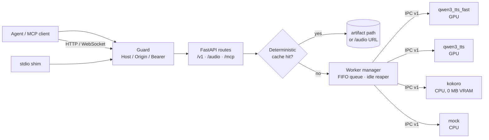

<div align="center">

# agent-voice

**Headless, UI-free, multi-engine voice cloning and speech synthesis server for AI agents.**

[](https://github.com/000jd/agent-voice/actions/workflows/ci.yml)
[](CHANGELOG.md)
[](pyproject.toml)
[](LICENSE)

</div>

> **Status: Beta (v0.4.0).** Linux + NVIDIA CUDA is verified on an RTX 4060 Ti 16 GB
> (driver 580.178.04, torch 2.11.0+cu128). **Kokoro-82M runs on the CPU** with zero
> GPU memory, on Linux and macOS. Windows is untested.

An agent asks for speech over MCP or HTTP; `agent-voice` keeps the GPU idle until
something actually needs it, routes the request to an isolated engine subprocess,
and returns a file path or a PCM stream. No desktop app, no web UI, no base64 blobs
in tool results. Most local TTS servers are built for humans — a window, a waveform,
a "Generate" button. Agents need deterministic caching, honest error codes, a GPU
that is genuinely free when idle, and tools that return compact JSON.

## At a glance

| | |
|---|---|
| **Daemon** | FastAPI + FastMCP, Python 3.12, core venv installs **no torch** |
| **Engines** | `mock` (CPU tone generator), `kokoro` (82M, **CPU-only**), `qwen3_tts` (official), `qwen3_tts_fast` (CUDA graphs) |
| **Voice modes** | clone a 3–10 s clip · nine Qwen preset speakers · eight Kokoro voices · design a voice from words |
| **Zero-GPU option** | Kokoro-82M: **0 MB VRAM**, native 24 kHz, **3.4–5.2× real time**, 1.37 GB RSS |
| **Markup** | `[pause 1.5s]`, `[slow]`, `[fast]`, `[emphasis]`, `[spell]`, paragraph gaps — parsed before synthesis |
| **Interfaces** | MCP (stdio + Streamable HTTP), REST, OpenAI-compatible, raw PCM stream, WebSocket with barge-in |
| **GPU when idle** | 0 workers, ~631 MiB VRAM (= desktop baseline) |
| **Cache** | SHA-256 over the full synthesis parameter set, consulted before a worker spawns |
| **Security defaults** | loopback bind, Host/Origin guard on HTTP **and** WS, agent mutation off, reference clips confined to an inbox |

## Requirements

- Linux or Windows; macOS runs the CPU engines (`kokoro`, `mock`).
- Python 3.12 for the core daemon (managed by `uv`), plus `uv` for engine venvs.
- `ffmpeg`/`ffprobe` on the `PATH` of the process that starts the daemon: every
  reference clip is canonicalised to 24 kHz mono WAV through them, and every
  non-WAV output format is converted the same way.
- `espeak-ng` for `kokoro` (English out-of-dictionary fallback and non-English
  G2P). Common English works without it; `agent-voice doctor` reports it.
- For GPU engines: an NVIDIA GPU with a recent driver. `kokoro` needs no GPU.

### Platform support

| Platform | Status | Notes |
|---|---|---|
| Linux + NVIDIA CUDA | **Verified** | Reference box: RTX 4060 Ti 16 GB, driver 580.178.04, torch 2.11.0+cu128 |
| Linux / macOS, CPU | **Verified** | `kokoro` (82M, 3.4–5.2× real time, 0 MB VRAM) and `mock` |
| Windows | **Untested** | Code paths exist (loopback TCP IPC, NSSM autostart); nobody has run the suite on Windows |

## Install

```bash
git clone https://github.com/000jd/agent-voice.git agent-voice
cd agent-voice
uv sync --extra dev && cp .env.example .env && uv run agent-voice doctor
```

`doctor` checks Python and `uv`, `ffmpeg`/`ffprobe`, the GPU, `espeak-ng` (when the
Kokoro engine ships), the port (free, or already serving a healthy daemon), engine
venvs, cached weights, the inbox and `.env` — one `PASS`/`FAIL`/`WARN` row per check
with a `fix:` line under every problem. It exits non-zero only on a `FAIL`, so a
CPU-only box or a checkout without `.env` still passes.

The core venv installs **no torch** — that is what makes the 0 MB idle GPU a
structural guarantee rather than a promise. Engine dependencies live in per-engine
venvs under `engines/<engine_id>/.venv`. `.env.example` ships mutation off, engine
approval on and inbox confinement on; see [SECURITY.md](SECURITY.md) first.

## Quickstart: CPU, Kokoro engine

Kokoro-82M is a real speech engine that needs **no GPU**: its venv installs CPU-only
torch from the `pytorch-cpu` index, and the worker never initialises CUDA.

```bash
uv run agent-voice engines install kokoro
uv run agent-voice models download kokoro kokoro-82m    # 363 MB, once
AGENT_VOICE_DEFAULT_ENGINE=kokoro uv run agent-voice serve
curl -s -X POST localhost:8000/v1/agent/speak \
  -H 'content-type: application/json' \
  -d '{"text":"Zero GPU, twenty-four kilohertz.","speaker":"af_heart"}'
```

8 English voices ship — `af_heart`, `af_bella`, `af_sarah`, `am_adam`, `am_michael`,
`bf_emma`, `bm_george`, `bm_lewis`. Measured on a Ryzen 7 5700X: **3.4–5.2× real
time**, 1.37 GB peak RSS and **0 MB VRAM**, streamed natively at 24 kHz. No cloning,
no voice design, no `instruct` — Kokoro is a preset-timbre engine, which is why it
is cheap to run. Details:
[docs/engines.md](docs/engines.md#kokoro-82m-the-cpu-engine).

The dependency-free `mock` engine is the other CPU option and the fastest way to
verify the plumbing (`AGENT_VOICE_DEFAULT_ENGINE=mock`); `mock-custom` answers
`speaker=` and `mock-design` answers `design_voice`, so the whole routing surface is
testable without a GPU:
`uv run agent-voice voices design probe --engine mock --model mock-design --instruct "quiet and precise"`.

## Quickstart: GPU engine

Two Qwen3-TTS backends ship, because their dependency sets are mutually exclusive
and cannot share a virtualenv:

| Engine | Package | Streaming | When to use |
|---|---|---|---|
| `qwen3_tts_fast` | `faster-qwen3-tts` (CUDA graphs) | native | default; fastest, native PCM streaming |
| `qwen3_tts` | `qwen-tts` (official) | emulated | fallback when graph capture misbehaves |

```bash
uv run agent-voice engines install qwen3_tts_fast
uv run agent-voice models download qwen3_tts_fast 1.7b-base
uv run agent-voice models download qwen3_tts_fast 1.7b-custom
uv run agent-voice serve
uv run agent-voice engines test qwen3_tts_fast   # 7/7 IPC v1 conformance
```

An OpenAI-SDK client can send `voice: "nova"`: with a `custom_voice` checkpoint
installed the daemon maps it to the `Serena` preset and reports that in
`x-agent-voice-speaker`. The agent endpoint takes an explicit timbre and returns
JSON with a file path:

```bash
curl -s -X POST localhost:8000/v1/agent/speak \
  -H 'content-type: application/json' \
  -d '{"text":"Good evening.","speaker":"Serena"}'
```

Honest throughput on the reference box with the official backend and 0.6B:
**10.5 s wall for 9.0 s of audio, warm — realtime multiple ≈ 0.86**, slightly slower
than real time; a cache hit returns in ~0.01 s. Numbers:
[docs/phase0-report.md](docs/phase0-report.md).

## Connect an agent

```bash
uv run agent-voice mcp-config --client claude-code
```

`mcp-config` prints a ready-to-paste configuration for the checkout it runs from,
with absolute paths filled in, for `claude-code`, `claude-desktop`, `vscode`,
`cursor` or `command-code`. Nothing is written to disk. `agent-voice mcp` is a stdio
shim: it starts the daemon if needed, then proxies MCP to it, so the agent process
never loads a model itself. Full snippets, Streamable HTTP MCP, LangChain, the OpenAI
SDK and autostart units: **[docs/install/agent.md](docs/install/agent.md)**.

## Models & licences

| Alias | Hugging Face repo | Params | VRAM | Mode | Licence |
|---|---|---|---|---|---|
| `kokoro-82m` | `hexgrad/Kokoro-82M` | 82M | **0 MB** | `custom_voice` | Apache-2.0 |
| `1.7b-base` | `Qwen/Qwen3-TTS-12Hz-1.7B-Base` | 1.7B | ~4.4 GB | `clone` | Apache-2.0 |
| `0.6b-base` | `Qwen/Qwen3-TTS-12Hz-0.6B-Base` | 0.6B | ~2.2 GB | `clone` | Apache-2.0 |
| `1.7b-custom` | `Qwen/Qwen3-TTS-12Hz-1.7B-CustomVoice` | 1.7B | ~4.4 GB | `custom_voice` | Apache-2.0 |
| `0.6b-custom` | `Qwen/Qwen3-TTS-12Hz-0.6B-CustomVoice` | 0.6B | ~2.2 GB | `custom_voice` | Apache-2.0 |
| `1.7b-design` | `Qwen/Qwen3-TTS-12Hz-1.7B-VoiceDesign` | 1.7B | ~4.4 GB | `voice_design` | Apache-2.0 |

The five Qwen3-TTS 12Hz checkpoints and Kokoro-82M are Apache-2.0 according to
their Hugging Face model cards; the `kokoro` engine code (`kokoro==0.9.4`) is
Apache-2.0 too. Weights are downloaded separately and remain under their own
licence; this repository's own code and `mock` are MIT. Which weights you pull, and
under what licence you use them, is your call.

## Expressive markup

Text is parsed for a small whitelist of tags before synthesis — on by default,
`markup=false` passes every bracket through literally:

| Tag | Effect |
|---|---|
| `[pause]`, `[pause 500ms]`, `[pause 1.5s]` | 0–10 s of silence at that point (`[pause]` alone = 400 ms) |
| `[slow]…[/slow]`, `[fast]…[/fast]` | ×0.82 / ×1.22 speed, clamped 0.5–2.0, multiplies `speed` |
| `[emphasis]…[/emphasis]` | 0.94× and +2.5 dB — a lift at stitch time, peak-limited |
| `[spell]…[/spell]` | say the inner text character by character (`HTTPServer` → "H T T P S E R V E R") |
| blank line | `paragraph_gap_ms` of silence (0 by default, max 5000) |

Anything else in brackets (`arr[0]`, `matrix[i][j]`, `[1, 2]`) stays literal text.
Subtitles keep the written text: `.srt`, `.vtt` and `beats[].text` never contain
tags. Caps (128 tags, depth 4, 32 segments) are checked before a worker spawns, so
`"Ship it [pause 400ms] — but [emphasis]read the diff[/emphasis] first."` is a
legal request. Grammar and precedence: [docs/api.md](docs/api.md#expressive-markup).

Every synthesis request also takes the v0.4.0 selectors: `markup` (default `true`),
`spell_identifiers` (default `false`), `paragraph_gap_ms` (0–5000) and `project`.
Per-beat values inherit from the script when a beat leaves them `null`.

## Lexicon, project scopes and code mode

Three layers stand between the text you wrote and what the engine says:

- **Lexicon** — the global `data/pronunciations.json`, plus optional
  `data/pronunciations/<project>.json` and `<voices>/<voice_id>/pronunciations.json`
  scopes. Precedence is global → project → voice → per-call `pronunciations={...}`;
  500 entries per scope, 1,500 merged.
- **`spell_identifiers`** — opt-in code normalization: `worker_manager` → "worker
  manager", `HTTPServer` → "HTTP Server", `v0.4.0` → "version zero point four dot
  zero", `C++` → "C plus plus".
- **`[spell]`** — an inline per-span override that wins over both.

```bash
uv run agent-voice pronunciations set kubectl "cube control" --project infra
uv run agent-voice pronunciations show --project infra
uv run agent-voice pronunciations check "kubectl get pods on GPU" --project infra \
  --spell-identifiers
```

`pronunciations check` is a read-only report — the terms that will be rewritten,
the ALL-CAPS acronyms the lexicon misses, and (with `--spell-identifiers`) the
code-like tokens the engine would otherwise mangle. It reads a file when the
argument is one. No synthesis, no daemon, no GPU.

## Architecture



The daemon holds no model code: each engine is a plugin directory with an
`engine.yaml` manifest and a `worker.py` speaking IPC v1, spawned lazily, routed to,
and reaped when idle. See [docs/engines.md](docs/engines.md) and
[engines/ADDING_AN_ENGINE.md](engines/ADDING_AN_ENGINE.md).

## Security & consent

- **Loopback by default.** The daemon binds `127.0.0.1`; a pure ASGI guard rejects
  a foreign `Host` (421) or `Origin` (403) on HTTP **and** WebSocket handshakes, and
  a non-loopback bind without `AGENT_VOICE_API_KEY` refuses to start.
- **Agent mutation is off.** `ALLOW_AGENT_ENGINE_MUTATION=false`; enabling it lets an
  agent write and execute Python, so it stays loopback-only and
  `REQUIRE_ENGINE_APPROVAL=true` stages plugins for human review.
- **Reference clips are confined.** `AGENT_VOICE_ALLOW_ANY_PATH=false` (default)
  means agent/MCP `clone_voice` reads only `<DATA_DIR>/inbox/`; the operator CLI
  `voices add` stays unrestricted.
- **Consent is yours.** Cloning a real person's voice without their consent is
  impersonation. The software runs locally and offline; the licence to use a voice
  does not come with it. See [SECURITY.md](SECURITY.md).

## Documentation

| Document | What is in it |
|---|---|
| [docs/api.md](docs/api.md) | Every endpoint, markup grammar, auth rules, MCP tools, `server_info`, return fields, scripts/timings, scoped lexicon |
| [docs/config.md](docs/config.md) | Every environment variable with its default and effect |
| [docs/engines.md](docs/engines.md) | Kokoro on CPU, five Qwen checkpoints, three modes, preset speakers, design→clone, adding an engine, GPU lifecycle |
| [docs/troubleshooting.md](docs/troubleshooting.md) | espeak-ng, spaCy model, CPU wheels, CUDA capture, tokenizer pin, ffmpeg, `doctor`, common errors |
| [docs/install/agent.md](docs/install/agent.md) | MCP client configs, HTTP MCP, LangChain/OpenAI, systemd and Windows autostart |
| [docs/phase0-report.md](docs/phase0-report.md) / [phase0-kokoro-report.md](docs/phase0-kokoro-report.md) | Measured GPU and CPU performance, dependency findings |
| [CHANGELOG.md](CHANGELOG.md) | Release history, v0.1.0 → v0.4.0 |
| [CONTRIBUTING.md](CONTRIBUTING.md) · [SECURITY.md](SECURITY.md) | Dev setup and gates · supported versions and threat model |
| [AGENTS.md](AGENTS.md) | Architecture and house rules for agents working on this repo |
| [skills/agent-voice/SKILL.md](skills/agent-voice/SKILL.md) | Installable agent skill / playbook (also served as `agent-voice://guide`) |
| [engines/ADDING_AN_ENGINE.md](engines/ADDING_AN_ENGINE.md) | The engine contract, IPC v1 and worked examples |
| [examples/manim_demo/](examples/manim_demo/) | End-to-end timed narration rendered with Manim and muxed with ffmpeg |

## Development

```bash
uv sync --extra dev
uv run ruff check . && uv run python -m pytest -v   # no GPU, no torch
uv run agent-voice engines test mock                 # IPC v1 conformance
uv run agent-voice pronunciations check "HTTPServer"  # lexicon/code preview
```

(If you call the `pytest` console script directly, prefix `PYTHONPATH=.` —
`tests/conftest.py` imports `tests._fake_clock`.) CI runs the same gates on Python
3.12 with no GPU and no secrets; see [CONTRIBUTING.md](CONTRIBUTING.md).

## License

MIT. Architectural inspiration came from `debpalash/VoiceStudio` (AGPL-3.0); no
code was copied from it. See [LICENSE](LICENSE).
