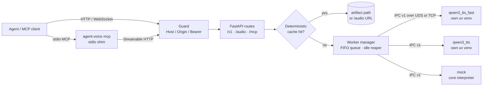

<div align="center">

# agent-voice

**Headless, UI-free, multi-engine voice cloning and speech synthesis server for AI agents.**

[](https://github.com/000jd/agent-voice/actions/workflows/ci.yml)
[](CHANGELOG.md)
[](pyproject.toml)
[](LICENSE)

</div>

> **Status: Beta (v0.3.3).** Linux + NVIDIA CUDA is verified on an RTX 4060 Ti 16 GB
> (driver 580.178.04, torch 2.11.0+cu128). Windows is untested. macOS runs the
> dependency-free `mock` engine only — no CUDA engine works there.

An agent asks for speech over MCP or HTTP; `agent-voice` keeps the GPU idle until
something actually needs it, routes the request to an isolated engine subprocess,
and returns a file path or a PCM stream. No desktop app, no web UI, no base64 blobs
in tool results.

Most local TTS servers are built for humans: a window, a waveform, a "Generate"
button. Agents need something else — deterministic caching, honest error codes, a
GPU that is genuinely free when idle, and MCP tools that return compact JSON.
`agent-voice` is that server.

## At a glance

| | |
|---|---|
| **Daemon** | FastAPI + FastMCP, Python 3.12, core venv installs **no torch** |
| **Engines** | `mock` (CPU tone generator), `qwen3_tts` (official), `qwen3_tts_fast` (CUDA graphs) |
| **Voice modes** | clone a 3–10 s clip · nine preset speakers · design a voice from words |
| **Checkpoints** | five official Qwen3-TTS 12Hz checkpoints across three modes |
| **Interfaces** | MCP (stdio + Streamable HTTP), REST, OpenAI-compatible, raw PCM stream, WebSocket with barge-in |
| **GPU when idle** | 0 workers, ~631 MiB VRAM (= desktop baseline) |
| **Cache** | SHA-256 over the full synthesis parameter set, consulted before a worker spawns |
| **Security defaults** | loopback bind, Host/Origin guard on HTTP **and** WS, agent mutation off, reference clips confined to an inbox |

## Requirements

- Linux or Windows; macOS is supported for the `mock` engine only.
- Python 3.12 for the core daemon (managed by `uv`), plus `uv` for engine venvs.
- `ffmpeg` and `ffprobe` on the `PATH` of the process that starts the daemon —
  reference clips are canonicalised to 24 kHz mono WAV through them, and every
  non-WAV output format is converted the same way.
- For GPU engines: an NVIDIA GPU with a recent driver.

### Platform support

| Platform | Status | Notes |
|---|---|---|
| Linux + NVIDIA CUDA | **Verified** | Reference box: RTX 4060 Ti 16 GB, driver 580.178.04, torch 2.11.0+cu128 |
| Windows | **Untested** | Code paths exist (loopback TCP IPC, NSSM autostart); nobody has run the GPU suite on Windows |
| macOS | Mock engine only | No CUDA engine; `mock` exercises the full clone/preset/design routing surface on CPU |

## Install

```bash
git clone https://github.com/000jd/agent-voice.git agent-voice
cd agent-voice
uv sync --extra dev && cp .env.example .env && uv run agent-voice doctor
```

`doctor` checks Python and `uv`, `ffmpeg`/`ffprobe`, the GPU, the port (free, or
already serving a healthy daemon), engine venvs, cached weights, the inbox and
`.env`, printing one `PASS`/`FAIL`/`WARN` row per check with a `fix:` line under
every problem. It exits non-zero only on a `FAIL`, so a CPU-only box or a
checkout without `.env` still passes.

The core venv installs **no torch**. That is deliberate: it is what makes the
0 MB idle GPU a structural guarantee rather than a promise. Engine dependencies
live in per-engine venvs under `engines/<engine_id>/.venv`.

`.env.example` ships mutation off, engine approval on and inbox confinement on;
see [SECURITY.md](SECURITY.md) before changing those defaults.

## Quickstart: CPU, mock engine

The mock engine synthesises tones, needs no models, and is the fastest way to
verify the plumbing end to end.

```bash
AGENT_VOICE_DEFAULT_ENGINE=mock uv run agent-voice serve
```

In another shell:

```bash
curl -s localhost:8000/health
curl -s -X POST localhost:8000/v1/audio/speech \
  -H 'content-type: application/json' \
  -d '{"model":"tts-1","input":"Hello from agent voice."}' --output out.wav
```

The mock engine also carries the full routing surface: `mock-custom` answers
`speaker=` (`Ryan`, `Serena`) and `mock-design` answers `design_voice` / `instruct`,
so clone → preset → design is testable without a GPU:

```bash
uv run agent-voice voices design probe --engine mock --model mock-design \
  --instruct "quiet and precise, close-mic"
```

## Quickstart: GPU engine

Two Qwen3-TTS backends ship, because their dependency sets are mutually exclusive
and cannot share a virtualenv:

| Engine | Package | Streaming | When to use |
|---|---|---|---|
| `qwen3_tts_fast` | `faster-qwen3-tts` (CUDA graphs) | native | default; fastest, native PCM streaming |
| `qwen3_tts` | `qwen-tts` (official) | emulated | fallback when graph capture misbehaves |

```bash
uv run agent-voice engines install qwen3_tts_fast
uv run agent-voice models download qwen3_tts_fast 1.7b-base
uv run agent-voice models download qwen3_tts_fast 1.7b-custom
uv run agent-voice models download qwen3_tts_fast 1.7b-design
uv run agent-voice models list
```

Then start the daemon and speak a preset timbre — no reference clip required:

```bash
uv run agent-voice serve
curl -s -X POST localhost:8000/v1/audio/speech \
  -H 'content-type: application/json' \
  -d '{"model":"tts-1","voice":"nova","input":"Good evening."}' --output hello.wav
```

`nova` is an OpenAI builtin name; with a `custom_voice` checkpoint installed the
daemon maps it to the `Serena` preset and reports that in
`x-agent-voice-speaker`. For an explicit timbre, use the agent endpoint, which
returns JSON with a file path:

```bash
curl -s -X POST localhost:8000/v1/agent/speak \
  -H 'content-type: application/json' \
  -d '{"text":"Good evening.","speaker":"Serena"}'
```

Honest throughput on the reference box with the official backend and 0.6B:
**10.5 s wall for 9.0 s of audio, warm — realtime multiple ≈ 0.86**, i.e.
slightly slower than real time. A cache hit returns in ~0.01 s. Full numbers:
[docs/phase0-report.md](docs/phase0-report.md).

## Connect an agent

```bash
uv run agent-voice mcp-config --client claude-code
```

`mcp-config` prints a ready-to-paste configuration for the checkout it runs from,
with the absolute paths already filled in. Supported clients:
`claude-code`, `claude-desktop`, `vscode`, `cursor`, `command-code`. Nothing is
written to disk — pipe or copy the output into the client's config file.

`agent-voice mcp` is a stdio shim: it starts the daemon if it is not already
running, then proxies MCP to it, so the agent process never loads a model itself.
Full snippets for every client, Streamable HTTP MCP, LangChain, the OpenAI SDK
and autostart units live in **[docs/install/agent.md](docs/install/agent.md)**.

## Models & licences

| Alias | Hugging Face repo | Params | VRAM | Mode | Licence |
|---|---|---|---|---|---|
| `1.7b-base` | `Qwen/Qwen3-TTS-12Hz-1.7B-Base` | 1.7B | ~4.4 GB | `clone` | Apache-2.0 |
| `0.6b-base` | `Qwen/Qwen3-TTS-12Hz-0.6B-Base` | 0.6B | ~2.2 GB | `clone` | Apache-2.0 |
| `1.7b-custom` | `Qwen/Qwen3-TTS-12Hz-1.7B-CustomVoice` | 1.7B | ~4.4 GB | `custom_voice` | Apache-2.0 |
| `0.6b-custom` | `Qwen/Qwen3-TTS-12Hz-0.6B-CustomVoice` | 0.6B | ~2.2 GB | `custom_voice` | Apache-2.0 |
| `1.7b-design` | `Qwen/Qwen3-TTS-12Hz-1.7B-VoiceDesign` | 1.7B | ~4.4 GB | `voice_design` | Apache-2.0 |

The five Qwen3-TTS 12Hz checkpoints are Apache-2.0 according to their Hugging
Face model cards. Weights are downloaded separately and remain under their own
licence; this repository's own code and the dependency-free `mock` engine are
MIT. You are responsible for the licences of any weights you download.

## Architecture



The daemon holds no model code. Each engine is a plugin directory with an
`engine.yaml` manifest and a `worker.py` speaking IPC protocol v1; the manager
spawns it lazily, routes work to it, and reaps it when idle. See
[docs/engines.md](docs/engines.md) and
[engines/ADDING_AN_ENGINE.md](engines/ADDING_AN_ENGINE.md).

## Security & consent

- **Loopback by default.** The daemon binds `127.0.0.1`; a pure ASGI guard rejects
  a foreign `Host` (421) or `Origin` (403) on HTTP **and** WebSocket handshakes,
  and a non-loopback bind without `AGENT_VOICE_API_KEY` refuses to start.
- **Agent mutation is off.** `ALLOW_AGENT_ENGINE_MUTATION=false`; enabling it lets
  an agent write and execute Python, so it stays loopback-only and
  `REQUIRE_ENGINE_APPROVAL=true` stages plugins for human review.
- **Reference clips are confined.** `AGENT_VOICE_ALLOW_ANY_PATH=false` (default)
  means agent/MCP `clone_voice` reads only `<DATA_DIR>/inbox/`; the CLI
  `voices add` is an operator command and stays unrestricted.
- **Consent is yours.** Cloning a real person's voice without their consent is
  impersonation. The software runs locally and offline; the licence to use a voice
  does not come with it. See [SECURITY.md](SECURITY.md).

## Documentation

| Document | What is in it |
|---|---|
| [docs/api.md](docs/api.md) | Every HTTP and WebSocket endpoint, auth rules, MCP tools, `server_info`, return fields, scripts/timings, lexicon |
| [docs/config.md](docs/config.md) | Every environment variable with its default and effect |
| [docs/engines.md](docs/engines.md) | Five checkpoints, three modes, preset speakers, design→clone, adding an engine, GPU lifecycle, concurrency |
| [docs/troubleshooting.md](docs/troubleshooting.md) | CUDA graph capture, tokenizer pin, ffmpeg/ffprobe, `doctor`, common errors |
| [docs/install/agent.md](docs/install/agent.md) | MCP client configs, HTTP MCP, LangChain/OpenAI, systemd and Windows autostart |
| [docs/phase0-report.md](docs/phase0-report.md) | Measured performance, dependency findings, FastMCP API notes |
| [CHANGELOG.md](CHANGELOG.md) | Release history, v0.1.0 → v0.3.3 |
| [CONTRIBUTING.md](CONTRIBUTING.md) | Dev setup, lint/test gates, GPU opt-in, house rules |
| [SECURITY.md](SECURITY.md) | Supported versions, private reporting, threat model |
| [AGENTS.md](AGENTS.md) | Architecture and house rules for agents working on this repo |
| [skills/agent-voice/SKILL.md](skills/agent-voice/SKILL.md) | Installable agent skill / playbook (also served as `agent-voice://guide`) |
| [engines/ADDING_AN_ENGINE.md](engines/ADDING_AN_ENGINE.md) | The engine contract, IPC v1 and worked examples |
| [examples/manim_demo/](examples/manim_demo/) | End-to-end timed narration rendered with Manim and muxed with ffmpeg |

## Development

```bash
uv sync --extra dev
uv run ruff check . && uv run python -m pytest -v   # no GPU, no torch
uv run agent-voice engines test mock                 # IPC v1 conformance
```

(If you call the `pytest` console script directly, prefix `PYTHONPATH=.` —
`tests/conftest.py` imports `tests._fake_clock`.) CI runs the same gates on
Python 3.12 with no GPU and no secrets; see [CONTRIBUTING.md](CONTRIBUTING.md)
and [.github/workflows/ci.yml](.github/workflows/ci.yml).

## License

MIT. Architectural inspiration came from `debpalash/VoiceStudio` (AGPL-3.0); no
code was copied from it. See [LICENSE](LICENSE).
